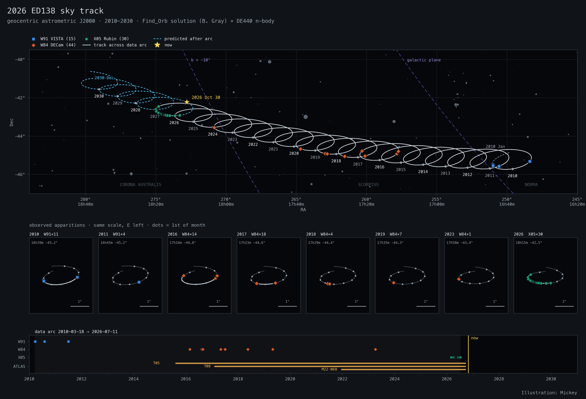
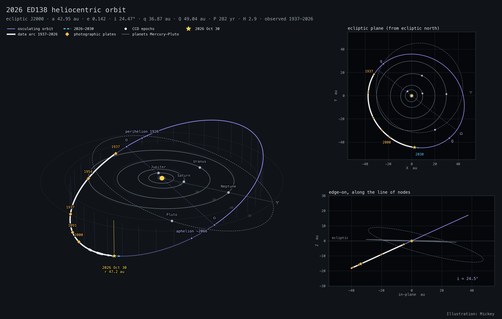
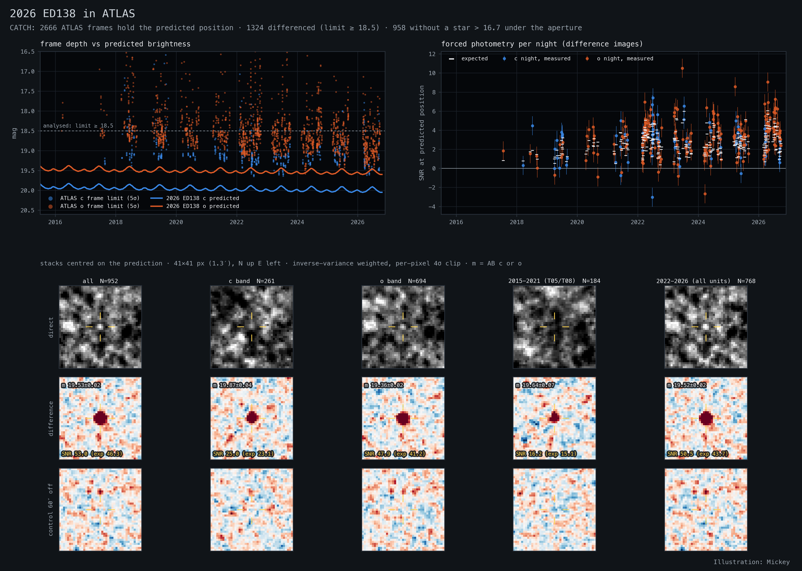
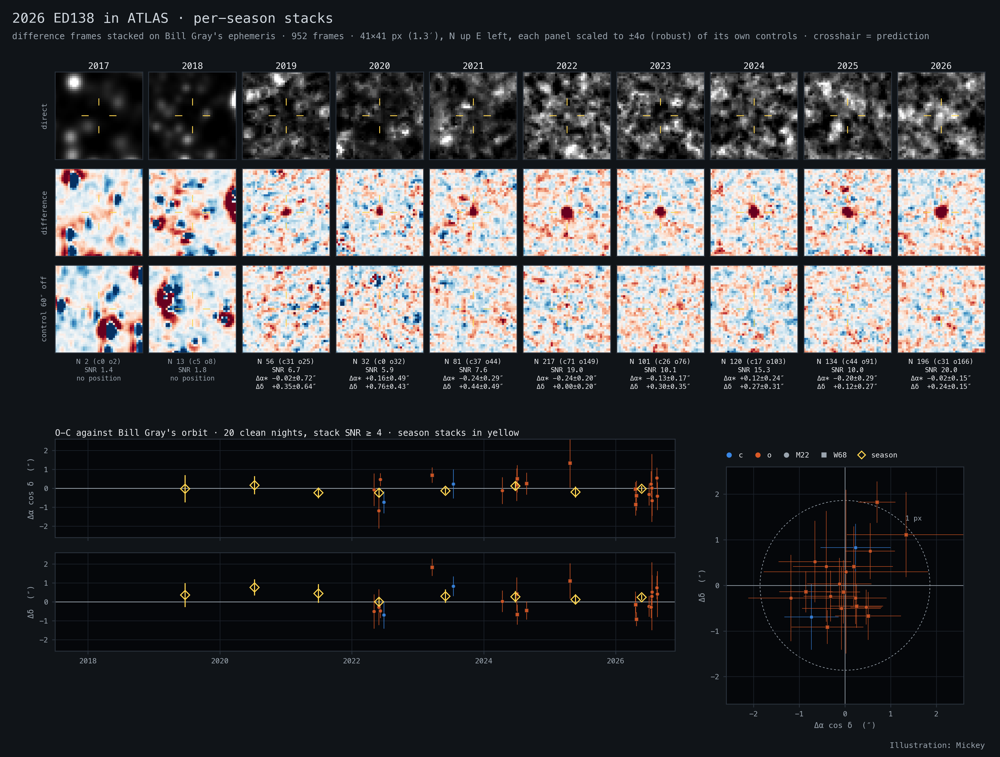

# 2026 ED138

A distant trans-Neptunian object and dwarf-planet candidate (H ≈ 2.9, roughly
700–1500 km). Rubin Observatory (X05) discovered it in 2026, and archival
measurements take its observed arc back to 1937.

**Interactive 3D orbit: <https://exoplanet5.github.io/2026ED138/>**

In the page you can drag to rotate and scroll to zoom. The time slider runs
from 1925 to 2031 (play at up to 1 yr per frame). There are presets for the
oblique, top, edge-on and inner-planet views (`#inner`, `#top`, `#edge` in
the URL also work). Hovering a photographic-plate marker shows its source.

## Orbit

Bill Gray's Find_Orb solution (pseudo-MPEC of 2026 Oct 28; 87 of 89
observations 2010–2026, mean residual 0.024″) is propagated as a test
particle. The perturbers are the Sun, the planet-system barycentres and
Pluto, all from JPL DE440.

| | |
|---|---|
| a, e, i | 42.955 au, 0.1417, 24.47° |
| q, Q, P | 36.87 au, 49.04 au, 281.5 yr |
| Ω, ω (J2000 ecliptic) | 322.50°, 168.02° |
| perihelion / aphelion | 1926 Feb 17 / about 2066 Nov |
| 2026 Oct 30 | r 47.22 au, Δ 47.74 au, V 19.8, RA 18h11m Dec −42.2° |

The MPC holds 101 observations from 1937-12-30 to 2026-07-11. Six of them
are photographic precoveries: the 1937 Harvard plate (DASCH), POSS-I red and
blue (1954), SERC-J (1977), SERC-R (1991) and SHS (2000). Extrapolated
back over 70 years, the 2010–2026 orbit still passes 0.4–2.9″ from every
one of them.

## Figures

**Sky track 2010–2030** (geocentric astrometric J2000). The data arc is
solid, the prediction dashed, and observations are marked by station. The
zoom panels show each observed apparition.

**Heliocentric orbit** (ecliptic J2000). The full 1937–2026 arc is shown
with the photographic plates, Mercury to Pluto, the nodes and the apsides,
in a top-down and an edge-on view.

**ATLAS recovery.** At c ≈ 19.9 and o ≈ 19.4 the object is below the
single-frame ATLAS limit (median 18.7). CATCH lists 2666 ATLAS frames from
2016–2026 that contain its predicted position. 952 of them were differenced
against other-night templates and stacked on the predicted motion. Together
they detect it at SNR 53, with the stack centroid within 0.23″ of the
prediction. It is detected in every season from 2019 to 2026, and the
controls 60″ away are flat. Measured magnitudes: c = 19.87 ± 0.04,
o = 19.36 ± 0.02 (AB, statistical errors only).

**ATLAS per-season stacks and astrometry.** Each column is one season's
direct, difference and control stack. Below them are the O−C of 20 clean
single-night shift-and-stack positions (2022–2026, M22 and W68) against Bill
Gray's orbit: rms 0.6–0.7″, mean +0.07″, −0.04″ ± 0.13″. These positions add
nothing to the orbit and have not been submitted to the MPC.

## Credits

Observations: Minor Planet Center. Orbit: Bill Gray, Find_Orb (projectpluto.com).
Ephemerides: JPL DE440. ATLAS images: CATCH and PDS Small-Bodies Node
(University of Maryland). Illustration: Mickey.
